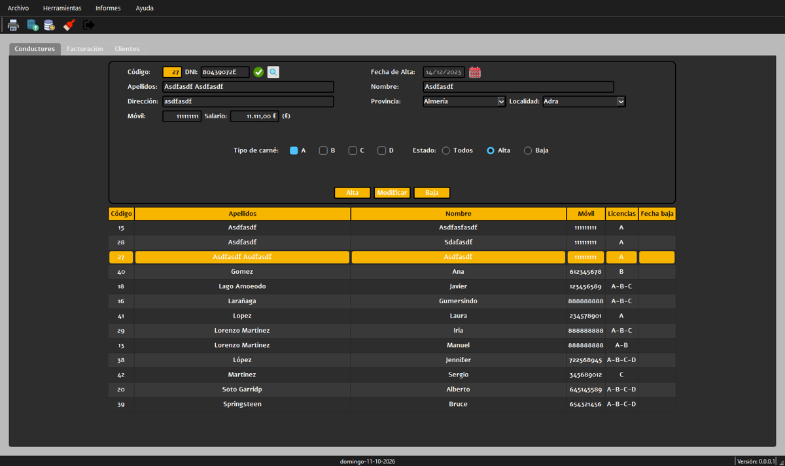

# CarTeis

Aplicación de escritorio para gestionar una empresa de taxis: conductores, clientes y facturación, con informes en PDF, copias de seguridad e importación/exportación a Excel.



Hecha con **Python 3.12**, **PyQt6**, **SQLite** y **reportlab**. Empezó como proyecto de fin de ciclo (IES de Teis, 2023) y se ha refactorizado por completo; la auditoría del código original, el plan por fases y las decisiones tomadas están en [`refactor_plan/`](refactor_plan/).

## Qué hace

- **Conductores y clientes:** alta, modificación, baja y reactivación, con validación de DNI/NIE, teléfono y salario. Las bajas no borran el registro: se filtra por activos, de baja o todos.
- **Facturación:** facturas con varios viajes. La tarifa por kilómetro depende de la ruta (local, provincial o nacional) y los totales incluyen el IVA.
- **Informes PDF:** listado de conductores, listado de clientes y factura.
- **Herramientas:** copias de seguridad en `.zip` (también restaura las de la versión original) e importación/exportación a Excel (`.xlsx`).

## Uso

```sh
python -m venv .venv
.venv/Scripts/python -m pip install -e ".[dev]"
.venv/Scripts/python -m carteis
```

La primera vez se crea la base de datos en la carpeta de datos del usuario (`%APPDATA%\CarTeis\CarTeis`) a partir de los datos de ejemplo de `resources/seed.sqlite`, que son ficticios. Los informes se guardan en `Documentos\CarTeis`.

Para generar el ejecutable de Windows: `pip install -e ".[build]"` y `pyinstaller carteis.spec` (crea `dist/CarTeis.exe`).

## Desarrollo

```sh
.venv/Scripts/python -m pytest --cov                        # tests (cobertura al 100 %)
.venv/Scripts/ruff check . && .venv/Scripts/ruff format --check .
.venv/Scripts/python tools/build_ui.py                      # tras editar un .ui en Qt Designer
.venv/Scripts/sphinx-build -W docs docs/_build/html         # documentación (extra "docs")
```

La documentación en [`docs/`](docs/) explica la [arquitectura](docs/arquitectura.rst) por capas (`domain`, `data`, `services`, `reports`, `ui`) y los [flujos de trabajo](docs/desarrollo.rst): cómo cambiar la interfaz, el estilo o el esquema de la base de datos.

## Estructura

```
carteis/            código de la aplicación
  domain/           reglas de negocio (sin Qt ni SQL)
  data/             SQLite: conexión, migraciones y repositorios
  services/         casos de uso que llama la interfaz
  reports/          informes PDF
  ui/               ventana, pestañas y diálogos (ui/generated/ lo genera pyuic6)
resources/          .ui, estilo (styles.qss), imágenes y base de datos inicial
tests/              tests con pytest y pytest-qt
tools/build_ui.py   genera el código de los .ui
docs/               documentación (Sphinx)
refactor_plan/      auditoría y plan de la refactorización
```

## Autor

[Javier Lago Amoedo](https://github.com/javierlago)
