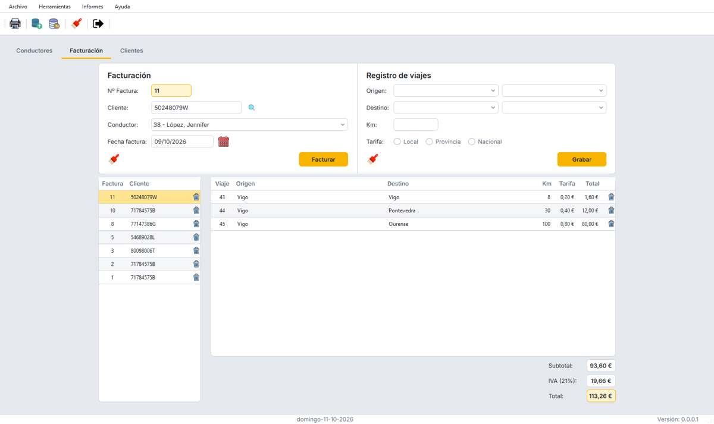
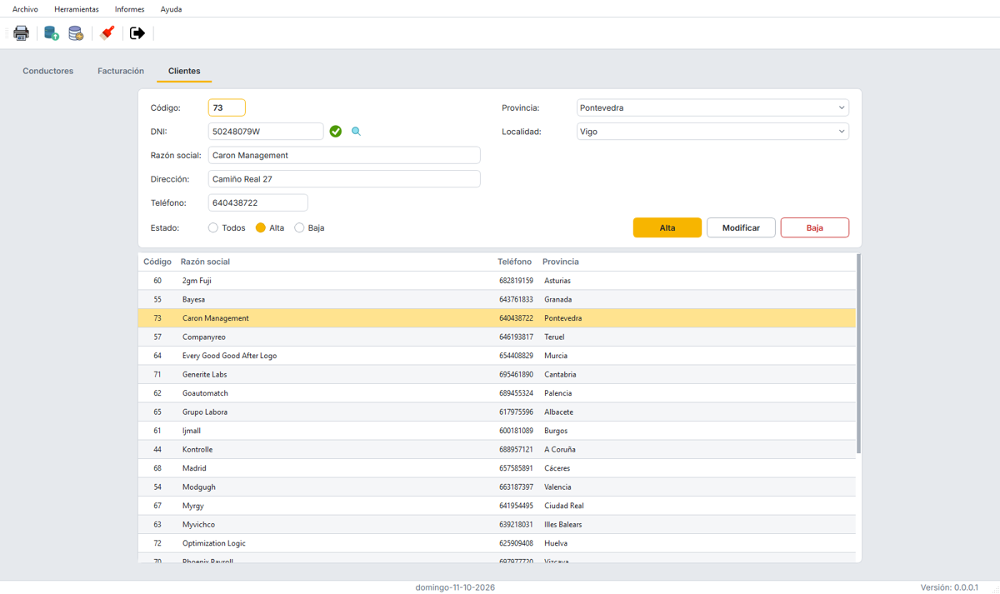
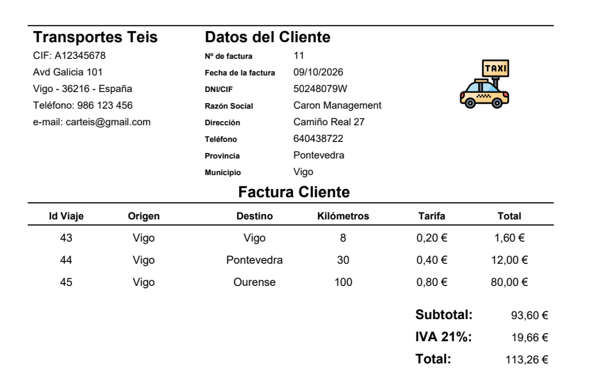

# CarTeis

Aplicación de escritorio para gestionar una empresa de taxis: **conductores**, **clientes** y **facturación**, con informes en PDF, copias de seguridad e importación/exportación a Excel.



## Sobre el proyecto

CarTeis nació como proyecto académico del ciclo formativo de grado superior de **Desarrollo de Aplicaciones Multiplataforma (DAM)**, que cursé en el **IES de Teis** (Vigo) entre 2023 y 2024. Fue mi primera aplicación de escritorio completa: interfaz gráfica, base de datos, validaciones, informes e importación de datos.

En 2026 lo **refactoricé por completo**, con el mismo stack tecnológico, para llevarlo a un nivel profesional:
- arquitectura por capas;
- tests automáticos con cobertura total;
- corrección de los bugs que tenía el código original;
- una interfaz rediseñada.

Todo el proceso está documentado en [`refactor_plan/`](refactor_plan/): la auditoría del código original, el plan por fases con las decisiones tomadas y las capturas de cada paso.

## Capturas

| Conductores | Clientes |
|---|---|
|  |  |

| Factura en PDF | Confirmación al salir |
|---|---|
|  |  |

## Funcionalidades

- **Conductores y clientes:** alta, modificación, baja y reactivación. Se valida el DNI/NIE con su letra de control, el teléfono y el salario. Las bajas no borran el registro: la lista se filtra por activos, de baja o todos.
- **Facturación:** facturas con varios viajes. La tarifa por kilómetro se calcula según la ruta (local, provincial o nacional) y los totales incluyen el IVA, con importes exactos al céntimo.
- **Informes PDF:** listado de conductores, listado de clientes (con el DNI enmascarado) y factura.
- **Copias de seguridad** en `.zip`. Antes de restaurar se valida el contenido, y también se pueden restaurar las copias hechas con la versión original.
- **Excel (`.xlsx`):** importación y exportación de conductores y clientes. Las filas rechazadas se indican con su número de fila y el motivo.

## Stack tecnológico

| Área | Tecnología |
|---|---|
| Lenguaje | **Python 3.12** |
| Interfaz | **PyQt6** (Qt 6): estilo Fusion con paleta propia y hoja de estilos `.qss`. Las pantallas se diseñan en **Qt Designer** y se generan con `pyuic6` |
| Base de datos | **SQLite** con `sqlite3`, esquema versionado con migraciones SQL |
| Informes | **reportlab** (generación de PDF) |
| Excel | **openpyxl** |
| Tipografía e iconos | **Inter** (SIL OFL), incluida en la app; **Lucide** (ISC) para la flecha de los desplegables |
| Tests | **pytest**, **pytest-qt** (interfaz sin pantalla), **pytest-cov**, **pypdf** (lectura de los PDF generados) |
| Calidad de código | **ruff** (lint y formato) |
| Documentación | **Sphinx** (referencia generada desde los docstrings) |
| Empaquetado | **PyInstaller** (ejecutable de Windows) |

## Arquitectura

El código está en el paquete `carteis`, organizado en capas con dependencias en un solo sentido:

```
ui  ──►  services  ──►  domain  ◄──  data
             │
             └──►  reports
```

- **domain:** reglas de negocio en Python puro, sin Qt ni SQL. Entidades que se validan al crearse, tarifas e importes con `Decimal`.
- **data:** acceso a SQLite, transacciones, migraciones y repositorios.
- **services:** los casos de uso que llama la interfaz (altas, facturación, copias, Excel, informes).
- **reports:** generación de los PDF.
- **ui:** ventana principal, un controlador por pestaña y diálogos. El aspecto se define en `resources/styles.qss`, con los colores en un único sitio.

Más detalle en [`docs/arquitectura.rst`](docs/arquitectura.rst).

## Instalación y uso

```sh
python -m venv .venv
.venv/Scripts/python -m pip install -e ".[dev]"
.venv/Scripts/python -m carteis
```

La primera vez se crea la base de datos en la carpeta de datos del usuario (`%APPDATA%\CarTeis\CarTeis`) a partir de `resources/seed.sqlite`, que contiene **datos de ejemplo ficticios**. Los informes se guardan en `Documentos\CarTeis`.

Para generar el ejecutable de Windows:

```sh
.venv/Scripts/python -m pip install -e ".[build]"
.venv/Scripts/pyinstaller carteis.spec        # crea dist/CarTeis.exe
```

## Desarrollo

```sh
.venv/Scripts/python -m pytest --cov                       # tests (cobertura del 100 %)
.venv/Scripts/ruff check . && .venv/Scripts/ruff format --check .
.venv/Scripts/python tools/build_ui.py                     # tras editar un .ui en Qt Designer
.venv/Scripts/sphinx-build -W docs docs/_build/html        # documentación (extra "docs")
```

Cómo cambiar la interfaz, el estilo o el esquema de la base de datos se explica en [`docs/desarrollo.rst`](docs/desarrollo.rst).

## Estructura del repositorio

```
carteis/            código de la aplicación
  domain/           reglas de negocio (sin Qt ni SQL)
  data/             SQLite: conexión, migraciones y repositorios
  services/         casos de uso
  reports/          informes PDF
  ui/               ventana, pestañas, diálogos y tema (ui/generated/ lo genera pyuic6)
resources/          .ui, estilo, fuentes, imágenes y base de datos inicial
tests/              tests con pytest y pytest-qt
tools/              generación del código de los .ui y descarga de iconos
docs/               documentación (Sphinx) e imágenes del README
refactor_plan/      auditoría, plan de refactorización y capturas del proceso
```

## Del proyecto original a hoy

| | Versión del ciclo (2024) | Versión actual (2026) |
|---|---|---|
| Arquitectura | Módulos acoplados mediante variables globales; SQL mezclado con la interfaz | Capas independientes sin estado global |
| Tests | Ninguno | 299 tests, cobertura del 100 % |
| Avisos de lint | 411 | 0 |
| Errores | Se ocultaban con `print` | Mensajes claros al usuario y registro en un log |
| Datos | Fechas como texto, importes en `float`, localidades escritas a mano | Esquema versionado, fechas ISO, importes exactos y claves foráneas |
| Interfaz | Distribución con tamaños fijos; dependía del tema y las fuentes del equipo | Rediseño claro, alineado en rejilla, con la misma apariencia en cualquier equipo |
| Arranque | Solo desde la carpeta del proyecto | Desde cualquier carpeta, con los datos en el perfil del usuario |

La interfaz original puede verse en [`refactor_plan/capturas/antes_conductores.png`](refactor_plan/capturas/antes_conductores.png).

## Licencias de terceros

- Fuente **Inter**: SIL Open Font License 1.1 ([`resources/fonts/Inter-LICENSE.txt`](resources/fonts/Inter-LICENSE.txt)).
- Iconos **Lucide**: licencia ISC ([`resources/img/icons/LICENSE-lucide.txt`](resources/img/icons/LICENSE-lucide.txt)).

## Autor

**Javier Lago Amoedo**, [@javierlago](https://github.com/javierlago).
